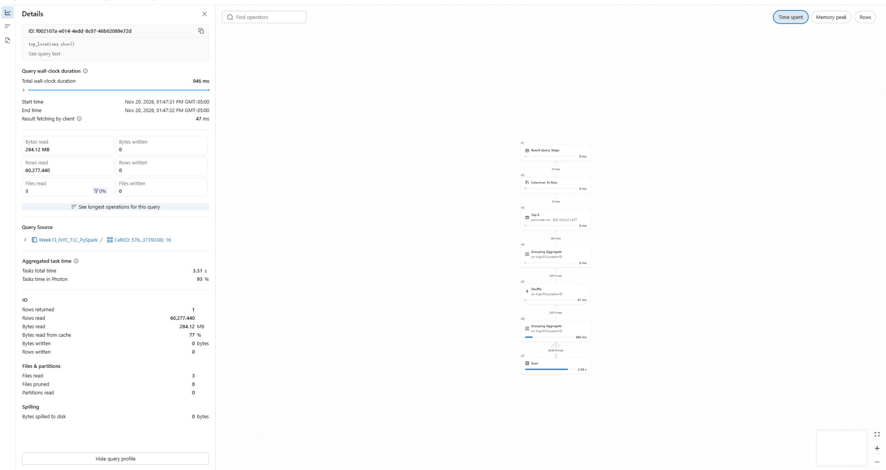

# NYC TLC High-Volume For-Hire Vehicle Trips — PySpark Data Processing

**Course assignment:** Week 13 Mini Assignment: PySpark Data Processing  
**Environment:** Databricks Serverless, Apache Spark 4.2.0, Photon  
**Data period:** January–March 2024

## 1. Dataset

This project analyzes the **New York City Taxi & Limousine Commission (TLC) High Volume For-Hire Vehicle (FHVHV)** trip records, covering three months of ride-hailing trips. The source publishes monthly Parquet files.

**Official dataset:** [NYC TLC Trip Record Data](https://www.nyc.gov/site/tlc/about/tlc-trip-record-data.page)

| Source file | Measured size (MiB) |
| --- | ---: |
| `fhvhv_tripdata_2024-01.parquet` | 450.86 |
| `fhvhv_tripdata_2024-02.parquet` | 441.05 |
| `fhvhv_tripdata_2024-03.parquet` | 484.41 |
| **Total** | **1.34 GiB** |

The source files contain **60,303,866 rows and 24 columns**. Two filters remove trips with nonpositive `trip_miles` or `base_passenger_fare`, leaving **60,277,440 valid trips** (26,426 rows excluded). These measurements are from the executed notebook; the repository does not include the large raw files.

## 2. Processing pipeline

The notebook performs the following operations with the PySpark DataFrame API and Spark SQL:

1. Download the three public monthly Parquet files into a Unity Catalog Volume and read them with `spark.read.parquet()`.
2. Apply **two filters early**: `trip_miles > 0` and `base_passenger_fare > 0`.
3. Use `.select()` to retain six analysis columns before other transformations (column pruning).
4. Create three columns with `.withColumn()`: `pickup_month`, `pickup_hour`, and `fare_per_mile`.
5. Run a multi-measure **`groupBy(pickup_month, pickup_hour)` aggregation** with trip counts, average base fares, and average distances.
6. Execute **two Spark SQL queries** through a temporary view: monthly trip summary and top 10 pickup-zone IDs by trip count.
7. Save the cleaned DataFrame as Parquet, **partitioned by `pickup_month`**.
8. Inspect the SQL query physical plan using `.explain(mode="formatted")`; verify partition pruning; demonstrate lazy transformations and an action.

The assignment allows a complex aggregation instead of a join; this project uses the complex aggregation path. MLlib and manual caching experiments are optional and were not included.

The main columns are `pickup_datetime`, `PULocationID`, `DOLocationID`, `trip_miles`, `base_passenger_fare`, and `hvfhs_license_num`. **Average fare refers only to `base_passenger_fare`; it is not a full charged fare including taxes, fees, or tips.**

## 3. Key findings

### Monthly summary

| Month (2024) | Valid trips | Avg. base fare (USD) | Avg. trip miles |
| --- | ---: | ---: | ---: |
| January | 19,653,311 | $23.97 | 4.84 |
| February | 19,347,478 | $24.28 | 4.93 |
| March | 21,276,651 | $25.55 | 4.95 |

March has the largest trip count and the highest average base fare among the three months. January's 8:00–8:59 hour-of-day group has **1,040,550 trips** in the hourly aggregation, compared with **296,792** trips in the 3:00–3:59 group. These are January totals grouped by clock hour across the month, not counts for a single day.

### Pickup locations

The two highest-volume pickup-zone IDs in the top-10 query are **138 (1,069,589 trips)** and **132 (1,058,813 trips)**. Their respective average base fares are **$52.42** and **$66.69**. The analysis reports TLC zone identifiers as IDs rather than making unverified claims about zone names.

## 4. Performance analysis

The formatted physical plan for the top-10 pickup-location query shows that Spark used the Photon execution engine and optimized the Parquet scan. The source has 24 columns, but `PhotonScan parquet` lists only **three data columns** in its `ReadSchema`: `PULocationID`, `trip_miles`, and `base_passenger_fare`. This is evidence of **column pruning**. Its `RequiredDataFilters` includes the positive-distance and positive-fare conditions, and `DictionaryFilters` also shows these predicates. Therefore, the predicates are applied at the scan stage. These plan details do not by themselves establish exactly how many Parquet row groups were skipped.

The plan contains `PhotonGroupingAgg` before and after a `PhotonShuffleExchange`, including `partial_count` and `partial_avg`. Partial aggregation reduces the intermediate records that must be merged across partitions. The query profile recorded a **946 ms query wall-clock duration**, **60,277,440 rows read**, **284.12 MB read**, **12 completed tasks**, **77% of bytes read from cache**, and **0 bytes spilled to disk**. Operator-level cumulative times include approximately **2.58 s for Scan**, **460 ms for Grouping Aggregate**, and **21 ms for Shuffle**; these are not additive wall-clock timings. Scan is the largest reported operator cost, while the profile does not suggest that shuffle or spilling dominated this execution.

For reusable output, the cleaned records were written as Parquet partitioned by `pickup_month`. Re-reading these files with `pickup_month = 3` produced **21,276,651 March rows**, and the physical plan explicitly showed `PartitionFilters: ... (pickup_month = 3)`, confirming **partition pruning**. This arrangement can reduce file reads for month-specific queries. The filters were placed early, and the query reads only necessary columns; no unnecessary explicit `.repartition()` was added to the analytical query. A controlled before/after timing benchmark was **not** performed, so this project reports observed optimization mechanisms rather than claiming a measured percentage speedup.

## 5. Transformations vs. actions

The notebook defines a new DataFrame with `filter()`, `select()`, and `withColumn()` without immediately executing a Spark job. Calling `explain()` displays the planned computation. The subsequent `count()` action triggers execution and returns **19,653,311 January trips**. This demonstrates Spark's lazy evaluation: transformations build a logical plan, while actions execute it.

## 6. Screenshots and evidence

The following screenshots are stored in [`screenshots/`](screenshots/):

| Screenshot | What it demonstrates |
| --- | --- |
| [`01_pipeline_success.png`](screenshots/01_pipeline_success.png) | Successful partitioned Parquet output (`_SUCCESS`, months 1–3) |
| [`02_execution_plan.png`](screenshots/02_execution_plan.png) | Physical execution-plan tree with Photon scan, aggregation, exchange, and top-K |
| [`03_query_profile.png`](screenshots/03_query_profile.png) | Query Profile, operators, query time, and read metrics |
| [`04_partition_pruning.png`](screenshots/04_partition_pruning.png) | March `PartitionFilters` in the physical plan |
| [`05_lazy_evaluation.png`](screenshots/05_lazy_evaluation.png) | Lazy transformations, physical plan, and `count()` action |

The full detailed plan (including `DictionaryFilters`, `ReadSchema`, `RequiredDataFilters`, and shuffle arguments) is also provided in [`execution_plan.txt`](execution_plan.txt).



## 7. Reproduction

1. Open [`Week13_NYC_TLC_PySpark.ipynb`](Week13_NYC_TLC_PySpark.ipynb) in a Databricks workspace with PySpark and permission to create a Unity Catalog Volume.
2. Run cells from top to bottom. The notebook creates and uses `workspace.default.nyc_tlc` at `/Volumes/workspace/default/nyc_tlc`. Change this path if your workspace has a different catalog or permission setup.
3. The notebook downloads the January–March 2024 TLC files from `https://d37ci6vzurychx.cloudfront.net/trip-data/`; external URL access and sufficient Volume storage are required.
4. The output is written to `/Volumes/workspace/default/nyc_tlc/processed_trips`, partitioned into `pickup_month=1`, `pickup_month=2`, and `pickup_month=3` folders. Running the write cell again overwrites that processed output.
5. Inspect the saved notebook output or the corresponding [`Week13_NYC_TLC_PySpark.html`](Week13_NYC_TLC_PySpark.html) export, and see the screenshots for query-profile evidence.

**Note:** Compute time and cache utilization depend on the Databricks runtime, workspace, and previous queries. The reported metrics refer to the captured run, not guaranteed timing on every rerun.

## 8. Submission contents

```text
Week13_NYC_TLC_Submission/
├── README.md
├── Week13_NYC_TLC_PySpark.ipynb
├── Week13_NYC_TLC_PySpark.html
├── execution_plan.txt
└── screenshots/
    ├── 01_pipeline_success.png
    ├── 02_execution_plan.png
    ├── 03_query_profile.png
    ├── 04_partition_pruning.png
    └── 05_lazy_evaluation.png
```

All numerical findings come from the saved Databricks notebook outputs or the supplied Query Profile screenshot. The large input data and generated Parquet data are not committed to GitHub.
